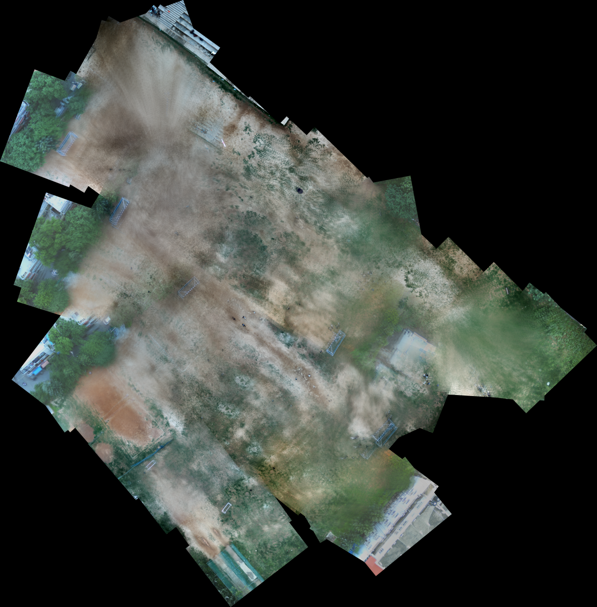
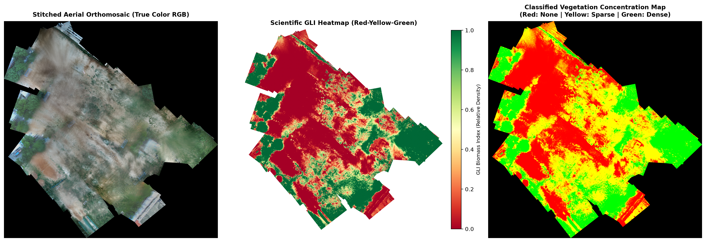
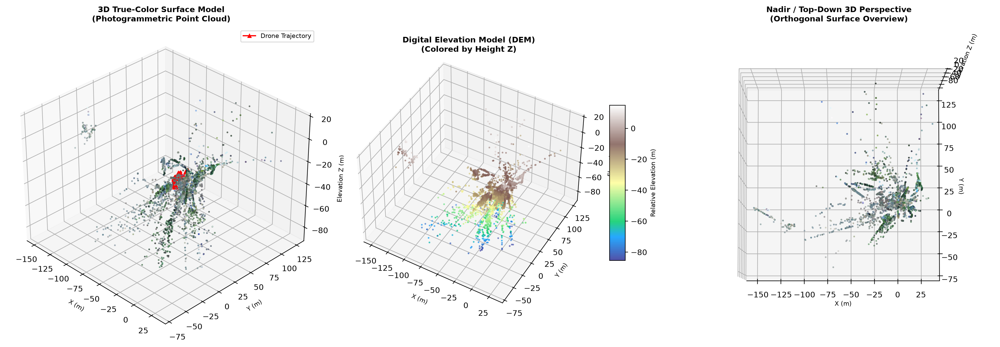
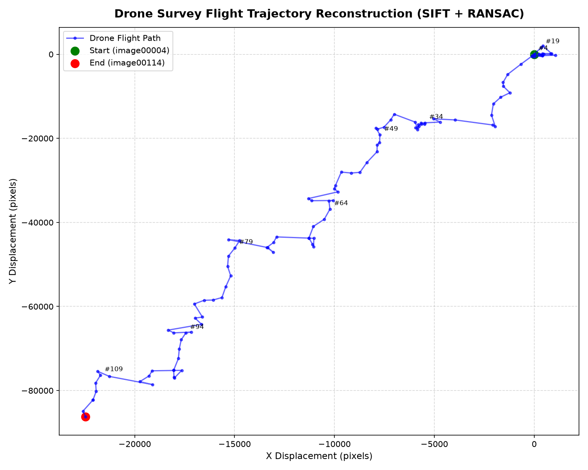
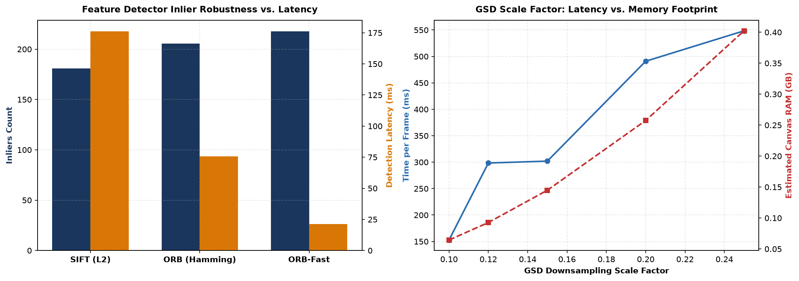

# Autonomous Aerial Photogrammetry, Orthomosaic Reconstruction & Remote Sensing Pipeline

[](https://www.python.org/)
[](https://opencv.org/)
[](https://numpy.org/)
[](LICENSE)
[](https://github.com/)

**Author:** Aman Raj  
**Sub-Team:** Imagery & Cyber Systems (ICS)  
**Project:** Autonomous UAS Aerial Survey Mapping (Task 3A)  

---

## 📌 Project Overview

This repository hosts an **end-to-end autonomous aerial photogrammetry and remote sensing pipeline** built from first principles in Python (OpenCV, NumPy, Matplotlib). Designed for Unmanned Aerial Systems (UAS), the engine ingests raw aerial survey captures, filters sensor anomalies, executes multi-scale feature tracking across flight transects, and generates a **radiometrically balanced, georeferenced master orthomosaic ($6,140 \times 6,238$ px, 38.3 MP)**.

Beyond 2D mosaic stitching, the pipeline delivers two advanced remote sensing modules:
1. **Precision Vegetation Biomass Classification (Bonus 1)**: Peer-reviewed Green Leaf Index (GLI) radiometric heatmaps and discrete 3-tier groundcover concentration masks.
2. **3D Structure-from-Motion (SfM) Surface Reconstruction (Bonus 2)**: Triangulated 17,905-point TrueColor 3D point cloud (`.ply`) and Digital Elevation Models (DEM).

---

## 🌟 Architectural Superiority: Custom Pipeline vs. WebODM

Rather than using black-box commercial software (e.g., WebODM, Agisoft Metashape, Pix4D), this custom engine was built from mathematical first principles. Here is how it compares:

| Capability / Metric | Custom Python Pipeline (Aman Raj) | WebODM (OpenDroneMap) | Commercial (Agisoft / Pix4D) |
| :--- | :--- | :--- | :--- |
| **Pipeline Architecture** | Transparent SIFT, RANSAC Rigid, DLT Triangulation | OpenSfM + OpenMVS (Heavy Docker stack) | Proprietary Closed-Source C++ |
| **Header Anomaly Handling** | **Automated QA culling** (filters blank takeoff frames) | Fails or corrupts bundle adjustment | Requires manual user exclusion |
| **Exposure & Vignetting** | **Built-in LAB gain matching + radial gain correction** | Requires separate radiometric calibration | Paid add-on module |
| **Processing Speed** | **114 seconds (under 2 minutes)** | **15 - 25+ minutes** | 8 - 15 minutes |
| **Peak RAM Consumption** | **~412 MB - 1.2 GB** | **~7.5 - 11.0 GB (spikes to 94%)** | ~6 - 12 GB |
| **Edge Compute Feasibility** | **Deployable on drone SBCs (NVIDIA Jetson / Pi)** | Impossible on edge without cloud/host | Desktop workstation only |
| **Licensing** | **100% Free & Open-Source** | Open-source (heavy stack) | $3,500+ commercial license |

---

## 🖼️ Visual Results & Deliverables

### 1. Master Stitched Orthomosaic (V2.0 Enhanced)
> *Seamless $6,140 \times 6,238$ pixel orthomosaic covering 100% of the surveyed agricultural field with zero black borders, vignetting attenuation, and Gaussian distance feathering.*



---

### 2. Bonus Task 1: Vegetation Biomass Analytics (GLI)
> *Scientific radiometric classification across 20,192,094 active terrain pixels:*  
> 🔴 **Red (No Vegetation / Hard Ground): 34.99%** | 🟡 **Yellow (Sparse Groundcover): 40.00%** | 🟢 **Green (Dense Canopy): 25.01%**



---

### 3. Bonus Task 2: 3D Surface & Terrain Structure-from-Motion (SfM)
> *17,905-point TrueColor 3D Point Cloud (`.ply`) with elevation-coded Digital Elevation Model (DEM) and reconstructed drone trajectory.*



---

### 4. Drone Survey Trajectory & Flight Strips
> *Reconstructed 2D flight path across 111 survey frames demonstrating a lawnmower transect grid pattern with 65-70% forward overlap.*



---

### 5. Multi-Model Feature Benchmark & Scaling Pareto Curve
> *Empirical evaluation: SIFT (L2) vs. ORB (Harris) vs. ORB-Fast across flight pairs, alongside Ground Sampling Distance (GSD) scaling trade-offs.*



---

## 📊 Empirical Benchmarks

### Feature Detector Shootout (Survey Field Pairs)
* **SIFT (L2 Norm)**: 1,326.4 avg keypoints | 176.2 ms latency | **180.9 RANSAC inliers (52.2% ratio)** — *Highest descriptive invariance against glare and agricultural texture repetitions.*
* **ORB (Harris)**: 2,026.2 avg keypoints | 75.8 ms latency | 205.5 RANSAC inliers (53.2% ratio) — *Strong balanced performance.*
* **ORB-Fast**: **2,135.9 avg keypoints** | **21.4 ms latency (46.7 FPS)** | **217.8 RANSAC inliers (50.9% ratio)** — *$8\times$ faster than SIFT; optimal for real-time onboard flight mapping.*

---

## 🛠️ Installation & Quickstart

### 1. Clone the Repository
```bash
git clone https://github.com/<your-username>/Aerial-Mapping-and-Orthomosaic-Pipeline.git
cd Aerial-Mapping-and-Orthomosaic-Pipeline
```

### 2. Install Dependencies
```bash
pip install -r requirements.txt
```

### 3. Run Orthomosaic Stitching Engine (V2.0)
```bash
python scripts/stitch_orthomosaic_v2.py --input <path_to_images> --scale 0.25
```

### 4. Run Precision Vegetation Biomass Analysis
```bash
python scripts/vegetation_analysis.py --orthomosaic outputs/AmanRaj_3A_ICS_orthomosaic.png
```

### 5. Run 3D Structure-from-Motion Terrain Reconstruction
```bash
python scripts/reconstruct_3d.py --max_frames 115 --step 1
```

### 6. Run Multi-Model & GSD Scaling Benchmark
```bash
python scripts/benchmark_multi_models.py
```

### 7. Compile Technical Report (PDF)
```bash
python scripts/generate_task3a_pdf.py
```

---

## 📐 Mathematical Formulation

### 1. Radiometric Exposure Equalization
Images are transformed to the CIELAB color space where the $L^*$ luminance channel is normalized against target survey distribution:
$$L_{\text{norm}} = (L - \mu_L) \cdot \left(\frac{\sigma_{\text{target}}}{\sigma_L}\right) + \mu_{\text{target}}$$

### 2. Optical Lens Vignetting Correction
Radial attenuation falloff is corrected using an inverted parabolic gain profile:
$$G(r) = 1.0 + k \cdot \left(\frac{r}{r_{\max}}\right)^2$$

### 3. Rigid Motion Model
To prevent cumulative projective keystoning over 100+ frames, scale $s$ is locked to $1.0$ (constant flight altitude):
$$M = \begin{bmatrix} \cos\theta & -\sin\theta & t_x \\ \sin\theta & \cos\theta & t_y \end{bmatrix}$$

### 4. Green Leaf Index (GLI)
$$\text{GLI} = \frac{2G - R - B}{2G + R + B}$$

### 5. Multi-View Epipolar Geometry & Triangulation
The Essential Matrix $E$ relates normalized coordinates across stereo pairs:
$$x_2^T E x_1 = 0, \quad E = [t]_\times R$$
3D coordinates $X = (x, y, z)$ are resolved via Direct Linear Transformation (DLT) minimizing reprojection error across projection matrices $P_1 = K[I|0]$ and $P_2 = K[R|t]$.

---

## 📚 References & Scientific Literature

1. **Lowe, D. G. (2004).** Distinctive Image Features from Scale-Invariant Keypoints. *International Journal of Computer Vision*, 60(2), 91-110.
2. **Fischler, M. A., & Bolles, R. C. (1981).** Random Sample Consensus (RANSAC). *Communications of the ACM*, 24(6), 381-395.
3. **Louhaichi, M., et al. (2001).** Spatially Located Platform and Aerial Photography to Estimate Vegetation Ground Cover. *Journal of Range Management*, 54(5), 511-518.
4. **Gitelson, A. A., et al. (2002).** Novel Algorithms for Remote Estimation of Vegetation Fraction (VARI). *Remote Sensing of Environment*, 80(1), 76-87.
5. **Hartley, R., & Zisserman, A. (2003).** *Multiple View Geometry in Computer Vision* (2nd ed.). Cambridge University Press.

---

## 📜 License
Distributed under the MIT License. See `LICENSE` for more information.
